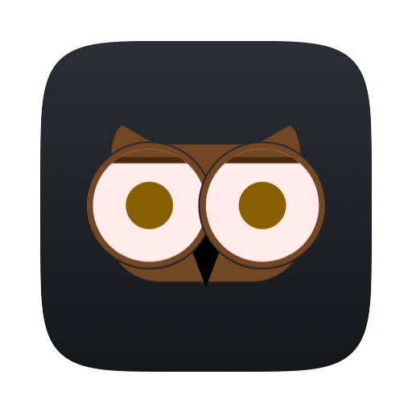
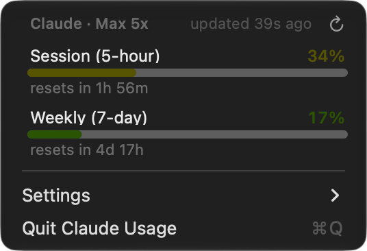

# Claude Usage

<p align="center"></p>

<p align="center">Part of <strong><a href="https://menumon.nicksmith.software">Menumon</a></strong>.</p>

<p align="center"></p>

**Version 1.21.2** · [Changelog](https://github.com/nicholaspsmith/claude-usage-menubar/releases)



A macOS menu-bar app for Claude Code: how much of your plan is left, when it
resets, and which agents are running. Built on
[StatusItemKit](https://github.com/nicholaspsmith/StatusItemKit).

## The menu-bar icon


The icon is Archimedes, an owl:

- **Eyelids** — the 5-hour session window. Open at 0%, half closed at 50%,
  shut at 100%.
- **Whites of the eyes** — the 7-day weekly window. They turn a deepening pink
  past 25% used, and red veins fade in over the last quarter.
- **Pupils** — also the weekly window: green (`#00860B`) at 0%, through orange to
  red (`#A50000`) at 100%.

**One Eye per Window** (Preferences, under Icon) gives each window an eye of
its own: the left eye is the session, the right the week. Each eye's lid
closes, its white goes pink and its pupil reddens with its own window's
percentage. Blinks and the go-outside shut-eye apply to both eyes either way.

Shut eyes with red pupils means both limits are spent. The bars in the menu use
the same green-to-red ramp, each by its own percentage, so the weekly bar
matches the pupils.

Prefer a colour per window? Preferences ▸ **Color** offers **Usage** (green
to red), the default described above, then three pairs: **Grape & Mint**, **Sky &
Tangerine** and **Lime & Fuchsia**. With a pair chosen the
session bar wears the first colour and the weekly bar the second, and so do
the pupils: with One Eye per Window the left pupil is the session colour and
the right the weekly; otherwise both pupils carry the week, so both are the
weekly colour. The whites still go pink and veined with usage.

Or pick your own: the last tile, **Custom**, shows the macOS colour picker for
the **Left Eye** and the **Right Eye**. Tick **Same Color for Both Eyes** to
pick one colour for both. The left eye's colour is also the session bar's and
the right eye's the weekly bar's; in the menu a colour is lightened or
darkened when that is needed to read it.

Now and then the owl blinks (550 ms). When several Menumon mascots are
running they take turns, a second apart: Archimedes (Claude Usage), Menu Pimp
(Mac Daddy), Carol (SoundChain), Iguanamous (VPN & DNS), then Armonitor
(Panes), counting only the ones that are running. The blink is
skipped when Reduce Motion is on.

Spend the whole weekly allowance with more than a day left before it resets
and Archimedes has a word: a speech bubble just under the menu bar, pointing
up at his beak, says **"Dude…go outside!"**. It bounces in over 2 seconds,
stays 5, fades out, and comes back once a minute until you click it. Click it
and he shuts his eyes, and keeps them shut (no blinking, whatever the session
window says) until the weekly window resets. Owl icon only; under Reduce
Motion it fades in without the bounce. To see it without spending a week,
quit the app and run `open -a "Claude Usage" --args --go-outside-preview`: it
speaks once, a moment after launch, and clicking that one only closes it.

Preferences ▸ **Icon** also offers plain meters — **Arc**, **Gauge**, **Pie** and
**Wedge**. These show the session window only, coloured from cyan at 0%
through blue and magenta to red at 100%, or in the session colour of a chosen
pair.

## Install

Part of the [macOS Dev Environment
Setup](https://github.com/nicholaspsmith/MacOS-Dev-Environment-Setup) suite —
`./bootstrap.sh --all` installs it along with everything else. To install it on
its own:

```bash
git clone https://github.com/nicholaspsmith/StatusItemKit.git ~/Code/StatusItemKit
git clone https://github.com/nicholaspsmith/claude-usage-menubar.git ~/Code/claude-usage-menubar
cd ~/Code/claude-usage-menubar && ./install.sh
```

`StatusItemKit` must sit **beside** this repo: the package depends on it by
relative path (`../StatusItemKit`).

`install.sh` builds the bundle, symlinks `~/Applications/Claude Usage.app` to
`build/`, offers to turn on Start at Login (when run in a terminal), quits any
running copy and launches the new one. Re-run it to update.

**Requires** macOS 13+ and Xcode Command Line Tools, plus a Claude login:
either Claude Code signed in (`claude auth status` reports `loggedIn: true`)
or the app's own sign-in (below).

### Start at Login

Toggle it in Preferences (General ▸ Start at Login), or from the shell:

```sh
"$HOME/Applications/Claude Usage.app/Contents/MacOS/ClaudeUsage" --login on       # or: off, status
```

Start at Login is `SMAppService.mainApp`, which can only register the calling
process's own bundle, so the command must be the *installed* binary. A bare
`--login`, or `--login status`, only reports the current state.

## What the menu shows

| Section | Source |
|---|---|
| Plan (`Max 20x`, `Pro`) and the 5-hour and 7-day allowances, with reset countdowns | Anthropic's OAuth usage endpoint, polled every 60 s |
| Running Claude Code sessions and whether each is busy (off by default; Preferences ▸ **Show Sessions**) | `~/.claude/sessions/*.json` |

The rows are read-only, so their labels draw grey; the percentages and bars
keep their colours. Below them are
**Preferences…** (⌘,) and **Quit Claude Usage** (⌘Q).

## For scripts and agents

After every poll (once a minute, and on each manual refresh) the app writes
the numbers it shows to
`~/Library/Application Support/ClaudeUsage/usage.json`, atomically, so a
shell script, a launchd job or a Claude Code agent can read the meter
without opening the menu:

```json
{
  "schema": 1,
  "updatedAt": "2026-11-10T04:00:00Z",
  "plan": "Max 5x",
  "status": "",
  "limits": [
    { "window": "session", "label": "Session (5-hour)", "percent": 93, "fraction": 0.93,
      "resetsAt": "2026-11-10T05:00:00Z", "resetsInSeconds": 3600 },
    { "window": "weekly", "label": "Weekly (7-day)", "percent": 29, "fraction": 0.29,
      "resetsAt": "2026-11-14T04:00:00Z", "resetsInSeconds": 345600 }
  ]
}
```

`status` is empty when the numbers are current and says why when they are
missing or stale (signed out, offline), so a reader can tell "unknown" from
"0%". Nothing in the file is a secret. `ClaudeUsage --usage` prints the same
file:

```bash
"$HOME/Applications/Claude Usage.app/Contents/MacOS/ClaudeUsage" --usage \
  | jq '.limits[] | select(.window == "session") | .percent'
```

## Preferences

Menu ▸ **Preferences…** (⌘,) opens the **Claude Usage Preferences** window,
the same one every Menumon app has (Esc or ⌘W closes it):

- **General** — Start at Login, and Show Sessions.
- **Icon** — the shape, as tiles drawn the way the bar draws them: Arc, Gauge,
  Pie, Wedge or Owl. **One Eye per Window** (owl only) sits below.
- **Color** — Usage (green to red), one of the three pairs, or Custom: your
  own colour for each eye, or one for both.
- **Account** — Sign In with Claude… (Sign In Again… once the app has a login
  of its own) and Sign Out.

The version is at the bottom.

## Signing in

The app uses Claude Code's login when there is one. Otherwise — or when it
has lapsed — **Sign In with Claude…** (in Preferences ▸ Account, or in the menu
when the numbers are missing) runs the same claude.ai OAuth flow Claude
Code uses: the browser opens on the consent page, the app receives the code on
a localhost port, exchanges it for tokens, and reads the plan from the profile
endpoint. It requests the `user:profile` scope only, which can read usage but
cannot run inference or create API keys.

That login belongs to the app. It is stored in its own Keychain item
(`Claude Usage-credentials`), refreshed by the app ten minutes before it
expires, and preferred over Claude Code's when both exist. The app never
writes or refreshes Claude Code's credential: refresh tokens rotate, so
refreshing it would sign Claude Code out. Preferences ▸ Account ▸ **Sign Out** deletes
the app's own login and falls back to Claude Code's.

The flow uses Claude Code's OAuth client id, as other community tooling does;
Anthropic could change or restrict it.

## The Keychain

Claude Code's token lives in the `Claude Code-credentials` Keychain item. The
app sends it only in the `Authorization` header of the usage request; the plan
name is the only other part of the credential shown in the UI.

Both Keychain items are read and written by running `/usr/bin/security`
rather than through the Security framework. The app is signed with a local
identity that has no Team ID, so macOS records it in the item's partition list
by CDHash. Every time Claude Code saves a refreshed token (`security
add-generic-password -U`) that list is rebuilt and the app's entry is dropped,
so a direct Keychain read would prompt for the login password about every
twelve hours, and again after every rebuild. `/usr/bin/security` sits in the
`apple-tool:` partition, which survives the rebuild, so it never prompts. A
successful read is cached in memory until the token nears expiry, so the
Keychain is read once per token, not once per poll.

If the read fails, the limits section says why ("Claude Code not signed in on
this Mac", "Keychain locked", "Keychain access denied"). The sessions section
keeps working, because it reads local files.

If the limits read **"Sign-in expired"**, start Claude Code (which refreshes
its own token) or use **Sign In with Claude…** to give the app a login it
refreshes itself.

## Development

```bash
swift build
swift test
scripts/build-app.sh    # builds build/Claude Usage.app
```

`ClaudeUsageCore` holds the parsing, OAuth and credential logic and has no
AppKit dependency, so it is fully unit-testable; the `ClaudeUsage` target is
the menu and icon.

## Releasing

Every push to `main` is a release. Before pushing, add a dated
`## [X.Y.Z] - YYYY-MM-DD` section to the top of [`CHANGELOG.md`](CHANGELOG.md)
(minor for features, patch for fixes; turn a waiting `## [Unreleased]` into
it). When it reaches `main`, GitHub tags `vX.Y.Z` and publishes the section as
a release titled `vX.Y.Z`. Without a new version:

- a push is refused locally by the `pre-push` hook;
- a pull request **cannot merge** — `release / check` is required on `main`;
- a push that reaches `main` anyway fails the release workflow.

The one exception is `[no release]` in the tip commit's message, for changes
nothing a user runs (setup, CI, developer docs): it passes every check with no
version bump and no tag. Never tag or create a release by hand, and never
`gh pr merge --admin` past a failing check — fix the PR. After merging, `git pull` for the tag and rebuild. `install.sh` re-arms the hook on a fresh clone.
See [StatusItemKit — Releases](https://github.com/nicholaspsmith/StatusItemKit#releases-every-push-is-one) for the whole rule.

## License

Copyright (c) 2026 Nicholas Smith. Licensed under the
[Mozilla Public License 2.0](LICENSE). You may use, modify, sell and
redistribute this software, including inside proprietary products, provided
the copyright notice and license stay on these files and any modified
versions of them are made available under the same license.

## The menu-bar suite

Part of a suite of macOS menu-bar apps that share one framework, one
build-and-sign script, and one installer. They are designed to sit in the
same bar together: consistent menus, a common **Icon** picker for shape and
colour, and cooperative hiding so no icon strands another.

| App | What it does |
|---|---|
| **Claude Usage** | Claude Code plan limits, resets, and live agent sessions |
| [Apollo Monitor](https://github.com/nicholaspsmith/apollo-monitor-menubar) | Apollo audio-interface monitor level |
| [Battery Time](https://github.com/nicholaspsmith/battery-time-menubar) | Time remaining, power mode, and 24h usage |
| [VPN & DNS](https://github.com/nicholaspsmith/vpn-dns-menubar) | An iguana for Mullvad + Tailscale state, with a DNS watcher |
| [Mac Daddy](https://github.com/nicholaspsmith/mac-daddy-menubar) | Kills media trackers, trashes stale downloads, reaps hung processes, watches the UA mixer engine, sweats as your process count climbs, and (optionally) a ⌘Space launcher for apps, arithmetic, unit conversions and emoji |
| [KeyLight](https://github.com/nicholaspsmith/keylight-menubar) | Ctrl+brightness keys remapped to keyboard backlight |
| [Homestead](https://github.com/nicholaspsmith/home-assistant-menubar) | Home Assistant dashboards and device controls in the menu |
| [Panes](https://github.com/nicholaspsmith/panes-menubar) | Window shortcuts, a layout grid and edge snapping, plus external-monitor brightness and contrast, the built-in screen from dimmer than macOS allows to XDR, and Night Shift |
| [SoundChain](https://github.com/nicholaspsmith/soundchain-menubar) | One chain of Audio Unit effects over all system audio |
| [MacRecorder](https://github.com/nicholaspsmith/MacRecorder) | Screen recording with system audio |
| [Barn](https://github.com/nicholaspsmith/menubar-barn) | macOS 26 and earlier only: hides a block of status icons by width (on macOS 27, use System Settings ▸ Menu Bar) |

| Framework | |
|---|---|
| [StatusItemKit](https://github.com/nicholaspsmith/StatusItemKit) | Status-item lifecycle, polling, menus, meter and mascot icons, the shared Icon picker |
| [HotkeyKit](https://github.com/nicholaspsmith/HotkeyKit) | CGEventTap engine for intercepting and remapping global keys |

Install the whole suite on a fresh Mac with
[macOS Dev Environment Setup](https://github.com/nicholaspsmith/MacOS-Dev-Environment-Setup):

```bash
git clone https://github.com/nicholaspsmith/MacOS-Dev-Environment-Setup.git
cd MacOS-Dev-Environment-Setup && ./bootstrap.sh --all
```
